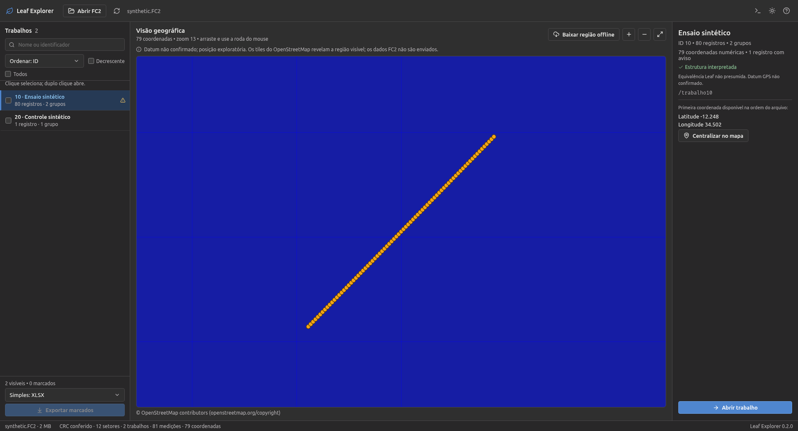

# Leaf Explorer com Tauri

A interface em `desktop/` usa Tauri 2 e mantém a biblioteca `fc2-rs` como única
implementação de leitura e exportação. A interface anterior em `gui/` continua
acessível durante a migração. CLI, TUI e seus contratos de exportação permanecem
independentes da nova interface.

## Direção visual

A referência visual é o [instalador do Ubuntu](https://ubuntu.com/blog/how-we-designed-the-new-ubuntu-desktop-installer/):
controles simples, superfícies neutras e tipografia Ubuntu incorporada ao
aplicativo. O destaque padrão é o azul usado no Fedora Linux (`#3c6eb4`, com
`#294172` na barra superior e `#51a2da` como realce). Não há vínculo com a
Canonical, o Ubuntu ou o Fedora Project.

O fluxo é o da GUI original, apenas com novo visual: ao abrir um FC2 aparece o
explorador com a lista de trabalhos à esquerda, a **visão geográfica com todos
os pontos do arquivo** no centro e os detalhes do trabalho à direita. Clicar em
um trabalho o destaca no mapa e o enquadra; clicar em um ponto seleciona o
registro e o trabalho correspondente; duplo clique (ou "Abrir trabalho")
abre a visão do trabalho, com as abas Medições, Mapa, Gráficos, Metadados e
Exportação, e "Voltar" retorna ao explorador.

- Trabalhos marcados para exportação são independentes do trabalho selecionado; os marcados são listados primeiro, com "Todos" e "Limpar marcações".
- Ordenação por ID, nome ou registros (crescente/decrescente) e busca por nome/identificador.
- "Exportar marcados" na lista: XLSX simples, completo ou JSON (um trabalho); a aba Exportação faz o mesmo para o trabalho aberto.
- Busca e filtros de grupo e de avisos nas medições, visíveis também nos gráficos e no mapa do trabalho.
- Cabeçalhos com ordenação (rótulo) e filtro por coluna (funil: intervalo numérico, texto ou avisos), que também valem para gráficos e mapa; paginação, inspeção dos bytes do registro e "Mostrar no mapa".
- Recarregar do disco, abrir a TUI, temas claro/escuro, atalhos e abertura por arrastar arquivo ou argumento de linha de comando.

Os gráficos respeitam os filtros da tabela e repetem o comportamento da GUI
original: barras de clorofila a, b, total ou todas, em "Média por ponto ± EP"
(agrupada por grupo e ponto, EP = desvio padrão amostral / √n, indisponível
com n = 1) ou "Todos os pontos" (uma barra por leitura, rotulada pelo ID), com
zoom, enquadramento, rolagem horizontal e dicas com arquivo de origem, valor
exato, IDs e avisos. Grupos mantêm sua identidade e o total de clorofila é o
valor armazenado, nunca A+B.

A aba Coordenadas é um mapa Web Mercator com arraste, roda do mouse, botões de
zoom, enquadramento (inclusive através do antimeridiano), seleção de
registros, alternância entre registros sobrepostos e "Mostrar no mapa" a
partir do inspetor (zoom 17). O fundo usa tiles do OpenStreetMap por padrão,
como na GUI original. Os tiles são buscados pelo lado Rust (comando `get_tile`,
com User-Agent identificável, no máximo duas requisições simultâneas e cache em
disco), não pelo webview; a consulta revela ao provedor a região visível, mas
nenhum dado FC2. O mapa é sempre exibido; sem conexão, os pontos continuam disponíveis.

"Baixar região offline" pré-carrega no cache em disco os tiles ao redor dos pontos de todo o arquivo (zoom 10 a 18, com margem de um tile). O plano (`offline_plan`) limita o download a 1.200 tiles, reduzindo o zoom máximo em áreas grandes e recusando áreas continentais; o download (`prefetch_tile`) é sequencial, com pausa de 250 ms entre requisições, pode ser interrompido e ignora tiles já em cache. É um pré-carregamento pequeno e localizado, não uma cópia em massa do mapa, em linha com a política de uso dos tiles do OpenStreetMap. O datum
das coordenadas não é confirmado; a posição é exploratória.

Também estão disponíveis: recarregar o FC2 do disco, ordenação da lista de
trabalhos (ID, nome, registros; crescente/decrescente), conferência de CRC na
barra de status, mensagens explicativas para avisos (códigos preservados) e
abertura da TUI em um terminal separado (Linux/macOS; no Windows use a CLI).

## Desenvolvimento

Use Node.js 22.12+ e Rust estável recente. A crate declara Rust 1.90 como base;
a validação local usou Rust/Cargo 1.99, sem certificação do mínimo declarado.
No Linux, instale as dependências nativas do
[Tauri 2](https://v2.tauri.app/start/prerequisites/), incluindo GTK 3, WebKitGTK 4.1,
D-Bus e ferramentas de compilação. No Windows, são necessários MSVC/Windows SDK
e WebView2.

```bash
cd desktop
npm ci
npm run tauri dev
```

O servidor de desenvolvimento escuta somente em `127.0.0.1:1420`. A aplicação
compilada incorpora o frontend e não depende desse servidor nem de Node.js.

```bash
# Somente prévia visual no navegador, sem acesso aos arquivos nativos
npm run dev

# Executável desktop, sem gerar instaladores
npm run tauri build -- --no-bundle

# Pacotes para o sistema de compilação
npm run tauri build
```

O executável Linux fica em `desktop/src-tauri/target/release/fc2-desktop` e aceita
um caminho FC2 como primeiro argumento. Linux, Windows e macOS exigem compilação
no ambiente correspondente. Os instaladores configurados são DEB, RPM, AppImage
e NSIS; os pacotes finais ainda precisam de teste nas plataformas de destino.
Os scripts antigos de distribuição em `scripts/` continuam empacotando a GUI egui.

Em ambientes Nix, as bibliotecas podem existir no store sem estarem expostas ao
`pkg-config`. Entre em um ambiente de desenvolvimento que exponha GTK 3,
WebKitGTK 4.1, D-Bus, Wayland e seus arquivos `.pc`. A configuração do sistema
não precisa ser alterada pela aplicação.

## Integração e segurança dos dados

`desktop/src-tauri/src/lib.rs` contém os modelos de apresentação e os contratos
com o decoder. `runtime.rs` registra os comandos locais `open_source`, `get_work`,
`get_locations`, `get_tile`, `offline_plan`, `prefetch_tile`, `export_selection`, `open_tui` e `initial_path`. A implementação segue o
[IPC do Tauri 2](https://v2.tauri.app/develop/calling-rust/).

Leitura e exportação usam tarefas em segundo plano. A sessão mantém uma origem
imutável em `Arc<LoadedDataset>`; detalhes e exportação verificam seu SHA-256 para
rejeitar seleções de outra origem. A exportação reutiliza os controles existentes
de cobertura, integridade e escrita sem sobrescrita. O seletor de pasta cria um
novo subdiretório para XLSX/pacote completo; JSON usa um seletor de arquivo e
também recusa sobrescrita. Falhas parciais são mostradas com os trabalhos bloqueados.

O frontend tem uma política CSP local e não recebe permissões genéricas de
filesystem ou shell. Não há upload, telemetria, fontes remotas ou CDN. O webview
não acessa a rede: a única conexão externa é a busca de tiles feita pelo Rust,
para o fundo do mapa. Os testes automatizados e as capturas versionadas usam exclusivamente dados sintéticos.

## Verificação

Na raiz do repositório:

```bash
cargo test --locked
cargo fmt --manifest-path desktop/src-tauri/Cargo.toml -- --check
cargo test --manifest-path desktop/src-tauri/Cargo.toml --locked --no-default-features
cargo clippy --manifest-path desktop/src-tauri/Cargo.toml --locked --all-targets -- -D warnings
```

Dentro de `desktop/`:

```bash
npm run format:check
npm run build
npx playwright install chromium
npm test
```

Para usar um Chrome já instalado, informe `FC2_CHROME_PATH=/caminho/google-chrome`.
Os testes de navegador simulam a fronteira IPC: verificam o fluxo e a apresentação,
mas não substituem testes dos diálogos nativos. Os testes Rust usam um FC2
sintético completo e verificam leitura, grupos, ausências, total independente,
identidade da fonte, seleção inválida e recusa de sobrescrita.

Validação local: build de produção do frontend, testes do decoder, testes da
ponte Rust, testes de navegador, Clippy e compilação nativa Linux. O compositor
confirmou uma janela `fc2-desktop` com título `Leaf Explorer`. A interação manual
com os seletores nativos e os instaladores Windows/Linux não está certificada.

Os treze testes de interface cobrem o layout em 800 × 620, 1240 × 820 e
1900 × 1026, busca, filtros, ordenação, inspeção, gráficos, mapa (online/local), recarga e exportação, além da recuperação de erros.
Em 1240 × 820, pelo menos 15 registros ficam visíveis junto à lista de trabalhos,
sem rolagem externa da janela.

A fonte Ubuntu Regular/Medium está incorporada, sem modificações, sob Ubuntu Font
Licence 1.0. Origem e avisos estão em `desktop/public/fonts/`.



Listas suspensas, menus de filtro e cartões de exportação são componentes próprios (`Select.tsx`, `ColumnFilter.tsx`), para seguir o tema do aplicativo em vez do tema do sistema. A barra superior acompanha o tema claro/escuro; o texto não usa corpos menores que 12 px.
