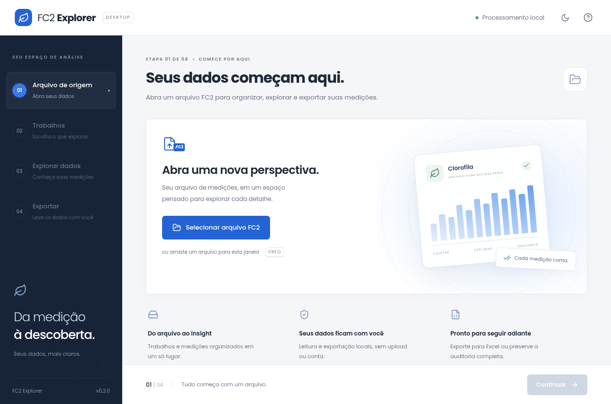

# FC2 Explorer com Tauri

A interface em `desktop/` usa Tauri 2 e mantém a biblioteca `fc2-rs` como única
implementação de leitura e exportação. A interface anterior em `gui/` continua
acessível durante a migração. CLI, TUI e seus contratos de exportação permanecem
independentes da nova interface.

## Direção visual

A referência é o [Anaconda Web UI do Fedora](https://fedoramagazine.org/anaconda-installer-redesign/):
fluxo guiado, navegação lateral persistente, conteúdo espaçoso, destaque azul,
revisão antes da ação e rodapé com ações previsíveis. A identidade e os recursos
gráficos são do FC2 Explorer; não há associação com o Fedora.

A interface oferece:

- Abertura por diálogo nativo, arrastar arquivo, `Ctrl O` ou argumento de linha de comando.
- Busca e seleção de trabalhos, contagens de registros/grupos/pontos e avisos.
- Tabela paginada, filtro de grupo e inspeção de bytes, hashes e segmentos de cada registro.
- Gráfico dos índices armazenados e dispersão local de coordenadas, sem serviços de mapas.
- Origem e limitações disponíveis junto aos dados.
- XLSX simples, pacote completo e auditoria JSON de um trabalho.
- Temas claro/escuro persistentes, navegação por teclado e respeito a movimento reduzido.

Os gráficos mostram registros individuais na ordem de origem, sem inferir
réplicas ou médias. Grupos mantêm sua identidade; o total de clorofila não é
recalculado a partir de A+B. O gráfico de coordenadas ajusta os eixos
independentemente, não representa distâncias e informa o datum desconhecido.

## Desenvolvimento

Use Node.js 22.12+ e Rust estável recente. A crate declara Rust 1.90 como base;
a validação local usou Rust/Cargo 1.99, sem certificação do mínimo declarado.
No Linux, instale as dependências nativas do
[Tauri 2](https://v2.tauri.app/start/prerequisites/), incluindo GTK 3, WebKitGTK 4.1,
D-Bus e ferramentas de compilação. No Windows, são necessários MSVC/Windows SDK
e WebView2.

```bash
cd desktop
npm ci
npm run tauri dev
```

O servidor de desenvolvimento escuta somente em `127.0.0.1:1420`. A aplicação
compilada incorpora o frontend e não depende desse servidor nem de Node.js.

```bash
# Somente prévia visual no navegador, sem acesso aos arquivos nativos
npm run dev

# Executável desktop, sem gerar instaladores
npm run tauri build -- --no-bundle

# Pacotes para o sistema de compilação
npm run tauri build
```

O executável Linux fica em `desktop/src-tauri/target/release/fc2-desktop` e aceita
um caminho FC2 como primeiro argumento. Linux, Windows e macOS exigem compilação
no ambiente correspondente. Os instaladores configurados são DEB, RPM, AppImage
e NSIS; os pacotes finais ainda precisam de teste nas plataformas de destino.
Os scripts antigos de distribuição em `scripts/` continuam empacotando a GUI egui.

Em ambientes Nix, as bibliotecas podem existir no store sem estarem expostas ao
`pkg-config`. Entre em um ambiente de desenvolvimento que exponha GTK 3,
WebKitGTK 4.1, D-Bus, Wayland e seus arquivos `.pc`. A configuração do sistema
não precisa ser alterada pela aplicação.

## Integração e segurança dos dados

`desktop/src-tauri/src/lib.rs` contém os modelos de apresentação e os contratos
com o decoder. `runtime.rs` registra quatro comandos locais: `open_source`,
`get_work`, `export_selection` e `initial_path`. A implementação segue o
[IPC do Tauri 2](https://v2.tauri.app/develop/calling-rust/).

Leitura e exportação usam tarefas em segundo plano. A sessão mantém uma origem
imutável em `Arc<LoadedDataset>`; detalhes e exportação verificam seu SHA-256 para
rejeitar seleções de outra origem. A exportação reutiliza os controles existentes
de cobertura, integridade e escrita sem sobrescrita. O seletor de pasta cria um
novo subdiretório para XLSX/pacote completo; JSON usa um seletor de arquivo e
também recusa sobrescrita. Falhas parciais são mostradas com os trabalhos bloqueados.

O frontend tem uma política CSP local e não recebe permissões genéricas de
filesystem ou shell. Não há upload, telemetria, fontes remotas, CDN ou mapas
externos. Os testes automatizados e as capturas versionadas usam exclusivamente dados sintéticos.

## Verificação

Na raiz do repositório:

```bash
cargo test --locked
cargo fmt --manifest-path desktop/src-tauri/Cargo.toml -- --check
cargo test --manifest-path desktop/src-tauri/Cargo.toml --locked --no-default-features
cargo clippy --manifest-path desktop/src-tauri/Cargo.toml --locked --all-targets -- -D warnings
```

Dentro de `desktop/`:

```bash
npm run format:check
npm run build
npx playwright install chromium
npm test
```

Para usar um Chrome já instalado, informe `FC2_CHROME_PATH=/caminho/google-chrome`.
Os testes de navegador simulam a fronteira IPC: verificam o fluxo e a apresentação,
mas não substituem testes dos diálogos nativos. Os testes Rust usam um FC2
sintético completo e verificam leitura, grupos, ausências, total independente,
identidade da fonte, seleção inválida e recusa de sobrescrita.

Validação local: build de produção do frontend, testes do decoder, testes da
ponte Rust, testes de navegador, Clippy e compilação nativa Linux. O compositor
confirmou uma janela `fc2-desktop` com título `FC2 Explorer`. A interação manual
com os seletores nativos e os instaladores Windows/Linux não está certificada.


